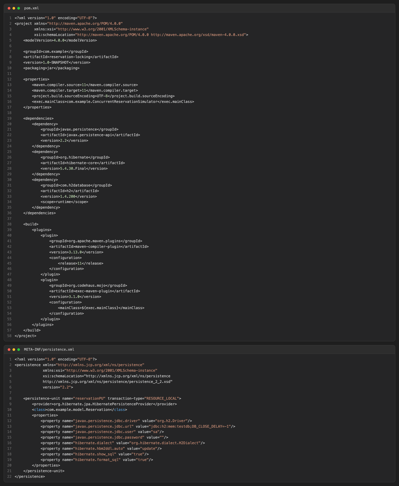
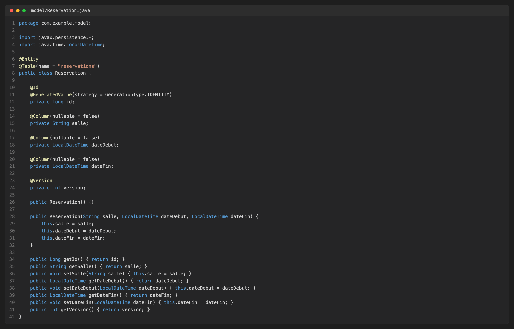
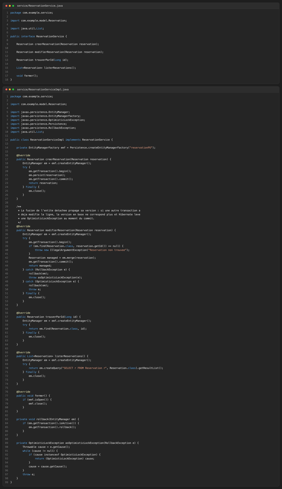
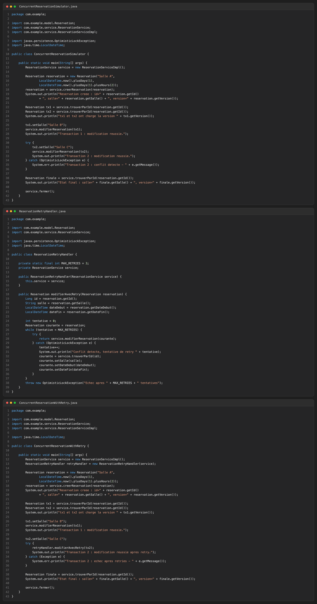
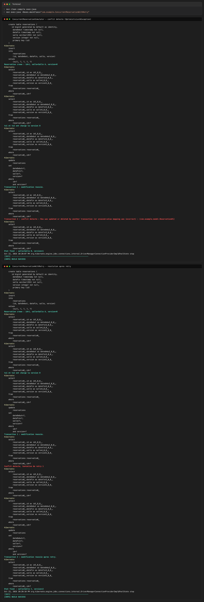

# TP 6 — Simuler un conflit de réservation concurrent et démontrer l'optimistic locking avec @Version

## 1. Configuration Maven et persistence.xml

## 2. Entité Reservation avec le champ @Version

## 3. Service de gestion des réservations

## 4. Simulation du conflit et stratégie de retry

## 5. Exécution — conflit détecté puis résolu après retry

